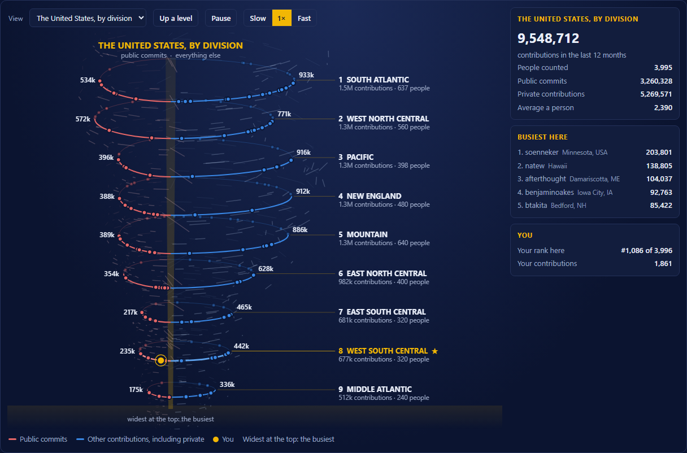

# GitHub Contribution Tornado

[](https://github.com/wbp318/github-leaderboard/actions/workflows/refresh.yml)
[](LICENSE)

> [!TIP]
> **Runs best in Chromium.** The tornado is a live canvas animation, and it is at its smoothest in Chromium and the browsers built on it (Chrome, Edge, Brave, Arc, Opera, Vivaldi). Firefox and Safari work too, just not as smoothly.
>
> - **Windows:** `winget install Hibbiki.Chromium`. This community build **never updates itself**, so keep it current: run `winget upgrade Hibbiki.Chromium` every few days, or have Windows check daily for you (below).
> - **macOS:** with [Homebrew](https://brew.sh), `brew install --cask ungoogled-chromium` (Chromium without Google's services). Homebrew's plain `chromium` package was retired in September 2026 because Apple's security check rejects it. If macOS will not open the app the first time, go to **System Settings → Privacy & Security** and choose **Open Anyway**. Homebrew does not update it on its own either: run `brew upgrade --cask ungoogled-chromium` now and then. Or use Google Chrome, which updates itself: `brew install --cask google-chrome`.
> - **Linux:** `sudo snap install chromium` (snaps update themselves), or your distribution's `chromium` package.

<details>
<summary><b>Have Windows update Chromium every day</b></summary>

Paste this into PowerShell once. It adds a task that runs `winget upgrade` for Chromium every morning at 9 (or as soon as the PC is next on), hidden, as you, with no administrator rights needed. The last run's output is in `%LOCALAPPDATA%\chromium-update.log`.

```powershell
$log = Join-Path $env:LOCALAPPDATA "chromium-update.log"
$run = "winget upgrade --id Hibbiki.Chromium --exact --silent --accept-source-agreements --accept-package-agreements > `"$log`" 2>&1"
Register-ScheduledTask -TaskName "Update Chromium" -Force `
  -Action (New-ScheduledTaskAction -Execute "conhost.exe" -Argument "--headless cmd.exe /c $run") `
  -Trigger (New-ScheduledTaskTrigger -Daily -At 9am) `
  -Settings (New-ScheduledTaskSettingsSet -StartWhenAvailable -AllowStartIfOnBatteries -DontStopIfGoingOnBatteries)
```

To stop it: `Unregister-ScheduledTask -TaskName "Update Chromium"`.
</details>

A year of GitHub contributions across the United States, drawn as a spinning tornado: all 50 states, the nine Census divisions and four regions, Louisiana parish by parish, and leaderboards in eight categories. About 34,000 developers found, the likeliest-busiest 80 in each state compared, refreshed every day by GitHub Actions. One HTML file, no frameworks, no dependencies.

**See it live: https://wbp318.github.io/github-leaderboard/** and type your GitHub login to see where you rank. Not on it? One click adds you.



## What is on the page

- **The tornado.** Each ring is a place, the busiest at the top. Its red half is public commits; its blue half is everything else: pull requests, reviews, issues, new repositories, and private contributions for people who show them. Click a ring to go down a level, from divisions to states to a state's busiest people.
- **Find yourself.** Type your GitHub login to see your ranks in your parish, state, division, region, and the country, with you in gold in the tornado, the lists, and the map. `?me=<login>` links straight to anyone's ranks. Open any other state to see where you would rank there, and the states table shows your rank in all 50 at once.
- **Add yourself.** Not on it? The **Add me** button opens a one-click issue; [a bot](https://github.com/wbp318/github-leaderboard/blob/main/.github/workflows/add-me.yml) checks your profile location, adds you, and replies with a link to your ranks in a few minutes. You are refreshed daily after that.
- **Leaderboards** in eight categories (total, public commits, private, pull requests, reviews, issues, new repositories, followers) for any state, division, region, or Louisiana parish, with each person's location. Search by login, name, or place.
- **A map** of all 50 states, coloured by contributions, people counted, or average.
- **Tables** of the states, the regions and divisions, and all 64 Louisiana parishes.

## How it works


1. **Find people.** [scripts/collect.mjs](scripts/collect.mjs) searches GitHub for users whose location names each state, by its name and by its two-letter code, and Louisiana again by its towns.
2. **Place them.** [src/states.mjs](src/states.mjs) reads each free-text location. Two-letter codes are shared around the world (MS is also Mato Grosso do Sul in Brazil, DE is Germany, IN is India, WA is Western Australia), so a code only counts when the city in front of it is not a known place abroad that uses the same code. Louisiana goes down to the parish with [src/parishes.mjs](src/parishes.mjs). [docs/placement.md](docs/placement.md) explains the rules, and the [tests](test/states.test.mjs) hold the hard cases.
3. **Look up contributions.** For each state, the 80 people most likely to be busiest (by public repositories and followers, among those who pushed code in the last year) get their year of contributions looked up, and every active Louisianan does for the parish view. States are always compared on the same 80 each. The busiest accounts are too big for GitHub to count in one query, so they are counted the long way rather than dropped; bot and test accounts are left off.
4. **Audit and build.** [scripts/audit.mjs](scripts/audit.mjs) lists what each rule placed and what it turned away; [scripts/build.mjs](scripts/build.mjs) adds everything up and writes it into [web/template.html](web/template.html).
5. **Every day** at about 4 a.m. Central, [a GitHub Actions workflow](.github/workflows/refresh.yml) refreshes what has gone stale (contributions daily, searches and profiles weekly), saves the data to the [`data` branch](https://github.com/wbp318/github-leaderboard/tree/data), audits it, and publishes the page. It uses the workflow's own token, so there are no secrets. [docs/data.md](docs/data.md) describes every file.

## Run it yourself

Node 24, no dependencies.

```sh
npm run data     # download the latest data
npm run build    # write site/leaderboard.html
npm test         # the placement rules
npm run audit    # data/audit.md
```

To collect from GitHub yourself (about an hour for every state), see [CONTRIBUTING.md](CONTRIBUTING.md#collect-the-data-yourself).

## Where things are

```
src/        placement rules: states.mjs, parishes.mjs, opt-out.txt
scripts/    collect, audit, build, fetch-data
web/        template.html, the whole page
site/       what GitHub Pages serves (leaderboard.html is built)
test/       placement test cases
docs/       placement.md, data.md, the screenshot
.github/    the daily workflow, issue forms
```

## Docs

- [How people are placed](docs/placement.md): the shared two-letter codes, the rules, the audit, and how to fix a mistake.
- [The data](docs/data.md): every file, every field, how it is collected, and the settings.
- [Contributing](CONTRIBUTING.md): running it, where to start, and ideas to pick up.

## What the numbers mean

- **Contributions** are GitHub's own count for the last 12 months, the number on a profile's contribution calendar.
- **Private contributions** count only for people who choose to show them on their profile.
- **It is a sample, not a census.** In each state the 80 people looked up are the likeliest to be busiest by their public signals, so someone very active who works mostly in private can be missed. Ranks are among the people counted.
- **People are placed by what their profile says.** Locations that stay ambiguous (Georgia the country, Washington DC, two places at once) are left out, and so are bot and test accounts.
- **It changes daily.** Contribution counts cover a rolling 12 months, so ranks move a little every day.

## Contributing

Ideas, fixes, and new views are welcome; [CONTRIBUTING.md](CONTRIBUTING.md) has how to run it, where things are, and ideas to pick up, and the [code of conduct](CODE_OF_CONDUCT.md) keeps it friendly. Someone in the wrong state? [Tell me](https://github.com/wbp318/github-leaderboard/issues/new/choose).

Everything shown comes from public GitHub profiles. To be left off, add your login to [src/opt-out.txt](src/opt-out.txt) or open an issue.

## License

[MIT](LICENSE)
