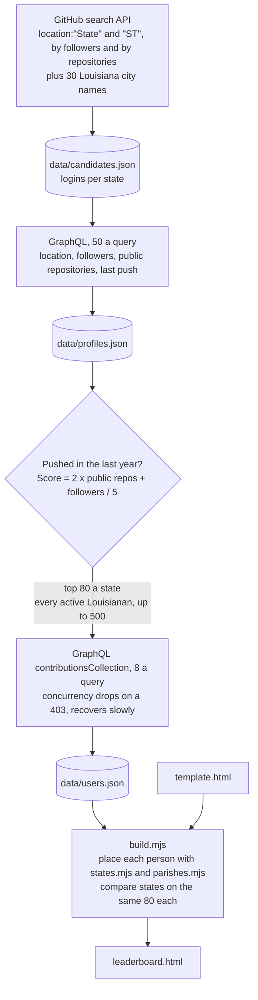

# github-leaderboard

A spinning-tornado leaderboard of GitHub contributions over the last 12 months, by state, Census region and division, and Louisiana parish.

The first pass covers the 16 states of the Census South plus Missouri: Alabama, Arkansas, Delaware, Florida, Georgia, Kentucky, Louisiana, Maryland, Mississippi, Missouri, North Carolina, Oklahoma, South Carolina, Tennessee, Texas, Virginia, and West Virginia. The other 33 states are on the map, dimmed, until they are collected.

Open [leaderboard.html](leaderboard.html) in a browser. It is one self-contained file with no network requests.

## What is on the page

- **The tornado.** Each ring is a place, busiest at the top: its red half is public commits, its blue half everything else (pull requests, reviews, issues, new repositories, and private contributions for people who show them). Click a ring to go down a level: states, then a state's busiest people. Divisions, regions, and Louisiana by parish are in the View menu.
- **Your ranks.** Tiles for your parish, state, division, region, and everyone counted.
- **Leaderboards.** Eight categories (total, public commits, private, pull requests, reviews, issues, new repositories, followers) for any state, division, region, or Louisiana parish, with each person's profile location. The search box finds a login, a name, or a place.
- **The map.** All 50 states as tiles, coloured by contributions, people counted, or average.
- **Tables.** The states, the regions and divisions, and all 64 Louisiana parishes.

## How it works



1. [collect.mjs](collect.mjs) searches each state by name and by abbreviation, and Louisiana again by city, then looks up cheap profile facts for every candidate.
2. It picks who gets the expensive contribution lookup: in each state, the 80 people most likely to be busiest among those who pushed code in the last year, and every active Louisianan (capped at 500) for the parish breakdown.
3. It fetches their contributions, paced to GitHub's secondary limit on GraphQL compute time. Everything is cached in `data/`, so a stopped run picks up where it left off.
4. [build.mjs](build.mjs) places each person in a state with [states.mjs](states.mjs) (a full state name, or "City, ST", with guards against Georgia the country, Paris, Ontario, and the like) and, in Louisiana, a parish with [parishes.mjs](parishes.mjs) (about 150 towns and universities). It aggregates everything and writes the data into [template.html](template.html) to make [leaderboard.html](leaderboard.html).

## Run it

Needs Node 24 and the GitHub CLI, logged in. The token is passed in the environment for the run and never written to disk.

```sh
GH_TOKEN=$(gh auth token) node collect.mjs   # about an hour for 17 states; safe to stop and rerun
node build.mjs
```

| Variable | Default | What it does |
|---|---|---|
| `SCOPE` | the South and Missouri | `all` for every state, or a comma-separated list such as `LA,MS,AR` |
| `PER_STATE` | `80` | How many people in each state get the contribution lookup, and are used to compare states |

`data/` is not committed: it is a cache of API responses, about 3 MB, and `collect.mjs` rebuilds it.

## What the numbers mean

- **Contributions** are GitHub's own count for the last 12 months, the number on a profile's contribution calendar.
- **Private contributions** count only for people who chose to show them on their profile.
- **It is a sample, not a census.** In each state the 80 people looked up are the likeliest to be busiest by public repositories and followers, so someone very active who works mostly in private can be missed. Ranks are among the people counted.
- **States are compared fairly.** Louisiana has more people looked up than other states, but states, divisions, and regions are always compared on the same 80 each; Louisiana's own view and its parishes use everyone.
- **Locations are free text.** People are placed by what they wrote on their profile; those who wrote only "Louisiana" are under "Parish not given".
