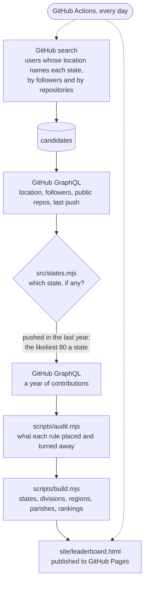

# GitHub Contribution Tornado

[](https://github.com/wbp318/github-leaderboard/actions/workflows/refresh.yml)
[](LICENSE)

A year of GitHub contributions across the United States, drawn as a spinning tornado: every state, the nine Census divisions and four regions, Louisiana parish by parish, and leaderboards in eight categories. Refreshed every day.

**See it live: https://wbp318.github.io/github-leaderboard/**


## What is on the page

- **The tornado.** Each ring is a place, the busiest at the top. Its red half is public commits; its blue half is everything else: pull requests, reviews, issues, new repositories, and private contributions for people who show them. Click a ring to go down a level, from divisions to states to a state's busiest people.
- **Your ranks** in your parish, state, division, region, and the country.
- **Leaderboards** in eight categories (total, public commits, private, pull requests, reviews, issues, new repositories, followers) for any state, division, region, or Louisiana parish, with each person's location. Search by login, name, or place.
- **A map** of all 50 states, coloured by contributions, people counted, or average.
- **Tables** of the states, the regions and divisions, and all 64 Louisiana parishes.

## How it works



1. **Find people.** [scripts/collect.mjs](scripts/collect.mjs) searches GitHub for users whose location names each state, by its name and by its two-letter code, and Louisiana again by its towns.
2. **Place them.** [src/states.mjs](src/states.mjs) reads each free-text location. Two-letter codes are shared around the world (MS is also Mato Grosso do Sul in Brazil, DE is Germany, IN is India, WA is Western Australia), so a code only counts when the city in front of it is not a known place abroad that uses the same code. Louisiana goes down to the parish with [src/parishes.mjs](src/parishes.mjs). The [tests](test/states.test.mjs) hold the hard cases.
3. **Look up contributions.** For each state, the 80 people most likely to be busiest (by public repositories and followers, among those who pushed code in the last year) get their year of contributions looked up, and every active Louisianan does for the parish view. States are always compared on the same 80 each.
4. **Audit and build.** [scripts/audit.mjs](scripts/audit.mjs) lists what each rule placed and what it turned away; [scripts/build.mjs](scripts/build.mjs) adds everything up and writes it into [web/template.html](web/template.html).
5. **Every day**, [a GitHub Actions workflow](.github/workflows/refresh.yml) refreshes what has gone stale, saves the data to the [`data` branch](https://github.com/wbp318/github-leaderboard/tree/data), and publishes the page.

## Run it yourself

Node 24, no dependencies.

```sh
npm run data     # download the latest data
npm run build    # write site/leaderboard.html
npm test         # the placement rules
npm run audit    # data/audit.md
```

To collect from GitHub yourself (about an hour for every state), see [CONTRIBUTING.md](CONTRIBUTING.md#collect-the-data-yourself).

## What the numbers mean

- **Contributions** are GitHub's own count for the last 12 months, the number on a profile's contribution calendar.
- **Private contributions** count only for people who choose to show them on their profile.
- **It is a sample, not a census.** In each state the 80 people looked up are the likeliest to be busiest by their public signals, so someone very active who works mostly in private can be missed. Ranks are among the people counted.
- **People are placed by what their profile says.** Locations that stay ambiguous (Georgia the country, Washington DC, two places at once) are left out.

## Contributing

Ideas, fixes, and new views are welcome; [CONTRIBUTING.md](CONTRIBUTING.md) has how to run it, where things are, and ideas to pick up. Someone in the wrong state? [Tell me](https://github.com/wbp318/github-leaderboard/issues/new/choose).

Everything shown comes from public GitHub profiles. To be left off, add your login to [src/opt-out.txt](src/opt-out.txt) or open an issue.

## License

[MIT](LICENSE)
