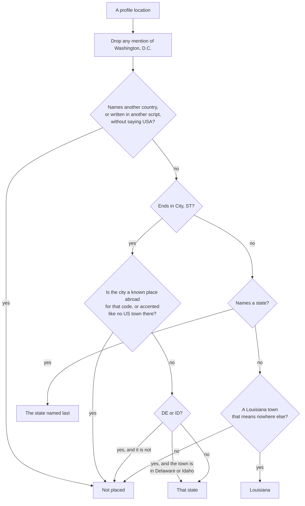

# How people are placed

A GitHub profile's location is free text: "Austin, TX", "New Orleans", "Remote", "Campo Grande, MS", "🏜️ ABQ,NM". [src/states.mjs](../src/states.mjs) reads it and decides which US state it names, if any. Getting this right is most of what makes the leaderboard trustworthy, and it is the easiest place to contribute.

## The problem: codes are shared

Two-letter codes after a city name are not only American. The same letters are used by other countries and by states and provinces abroad:

| Code | US state | Also |
|---|---|---|
| MS | Mississippi | Mato Grosso do Sul, Brazil (Campo Grande, Dourados) |
| SC | South Carolina | Santa Catarina, Brazil (Florianópolis, Blumenau) |
| AL | Alabama | Alagoas, Brazil (Maceió); Albania |
| MT | Montana | Mato Grosso, Brazil (Cuiabá); Malta |
| PA | Pennsylvania | Pará, Brazil (Belém) |
| MA | Massachusetts | Maranhão, Brazil; Morocco |
| DE | Delaware | Germany |
| IN | Indiana | India |
| TN | Tennessee | Tamil Nadu, India (Chennai); Tunisia |
| ID | Idaho | Indonesia |
| WA | Washington | Western Australia (Perth) |
| CO | Colorado | Colombia |
| AR | Arkansas | Argentina |
| IL | Illinois | Israel |
| MD | Maryland | Moldova |
| MO | Missouri | Moscow Oblast; Modena, Italy |
| VA | Virginia | Varese, Italy |
| SD | South Dakota | Sindh, Pakistan (Karachi); Sudan |
| LA | Louisiana | Los Angeles; Laos |

Before these rules, "Campo Grande, MS" (27 profiles) was counted in Mississippi.

## The rules, in order

1. **Another country.** A location that names another country (Brazil, India, Germany, and about a hundred more) or uses a script no US town is written in is not placed, unless it also says USA. US towns that share a country's name are listed so they still count: Norway, ME; Poland, OH; Little Canada, MN; Brazil, IN.
2. **"City, ST" wins.** A trailing two-letter code, optionally followed by USA, decides it, so "Missouri City, TX" is Texas and "Washington, PA" is Pennsylvania. It counts only if the city is not in the `ELSEWHERE` list for that code and carries no accents a US town in that state would not. Delaware and Idaho are stricter: their codes are written far more often by people in Germany and Indonesia, so only towns listed for those states count.
3. **The state named last.** "Kansas City, Missouri" is Missouri and "Washington Heights, New York" is New York. On a tie the longer name wins, so "West Virginia" is not Virginia.
4. **Louisiana towns.** "New Orleans", "Shreveport", "Ruston", and other names that mean only Louisiana place someone there; Louisiana then goes down to the parish with [src/parishes.mjs](../src/parishes.mjs).

Anything else, including "Remote", "Earth", "Georgia" next to Tbilisi, and two places at once in different countries, is left out. Leaving someone out costs a little coverage; placing them wrongly misleads everyone.

## Checking the rules

- **Tests.** [test/states.test.mjs](../test/states.test.mjs) holds over a hundred locations and where they belong. `npm test` runs them, and so does every pull request.
- **Audit.** `npm run audit` reads every profile found and writes `data/audit.md`: per state, how many were placed by each rule; every location a guard turned away; and every city accepted under a shared code. The daily run publishes it on the [`data` branch](https://github.com/wbp318/github-leaderboard/blob/data/data/audit.md).

Read the audit in both directions: a US town in "turned away" means a rule is too strict, and a foreign town in "accepted" means one is too loose.

## Fixing one

1. Add the location to [test/states.test.mjs](../test/states.test.mjs) with the right answer, `null` for "not in a US state".
2. Change [src/states.mjs](../src/states.mjs) until `npm test` passes. Usually that means adding a city to the `ELSEWHERE` list for its code, or a US town to `TOWNS_LIKE_ABROAD`, `ACCENTED_TOWNS`, `DELAWARE`, or `IDAHO`.
3. Run `npm run audit` and check nothing else moved.

Or [open an issue](https://github.com/wbp318/github-leaderboard/issues/new/choose) with the exact location text.

## Not on the leaderboard?

Each state looks up only its 80 likeliest-busiest people (and Louisiana everyone active), so most people are not on it. On the page, typing a login that is not there offers **Add me**, a one-click [issue](https://github.com/wbp318/github-leaderboard/issues/new?template=add-me.yml): the bot places whoever opens it with these same rules and replies with their ranks, or with why it could not place them.

## Other people who are left off

- **Bots and test accounts.** Logins with a separate `bot`, `robot`, or `test` part (`openshift-cherrypick-robot`, `amplify-github-test-hkg`) are automation, not people.
- **Anyone who asks.** Logins in [src/opt-out.txt](../src/opt-out.txt).
